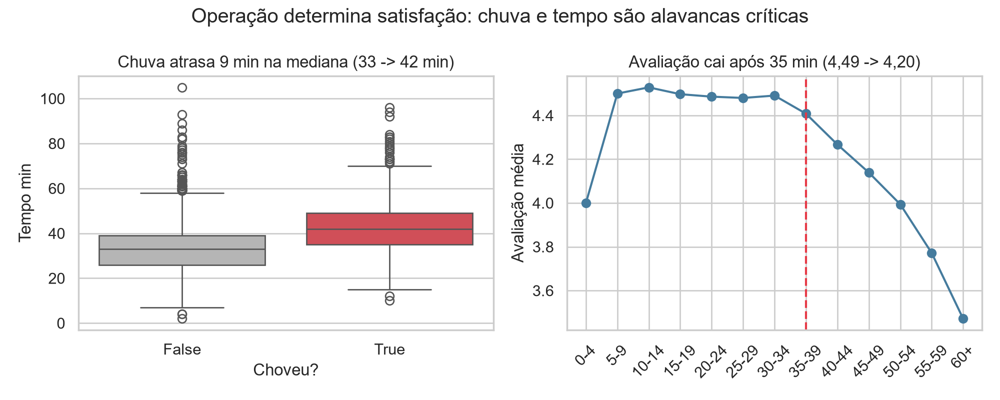

# Chuva e horário de pico atrasam as entregas e derrubam a avaliação: diagnóstico de 2024 do app de delivery

> Chuva aumenta a mediana do tempo de entrega em 9 minutos (33 → 42 min) e triplica o % acima de 45 min; acima de 35 min a avaliação já cai. A empresa deve adotar SLA dinâmico na chuva e travar um alerta em 35 min.



*Painel esquerdo: distribuição do tempo de entrega com e sem chuva; direito: avaliação média por faixa de tempo de 5 min. Base: 8.058 pedidos, 2024, São Paulo, Rio de Janeiro e Belo Horizonte.*

---

## 1. Pergunta de negócio

A diretoria do app de delivery pediu esta análise para planejar 2025. Foram investigadas três frentes: operação (quando e por que atrasa), clientes (quem paga quanto e como avalia) e alavancas (cupons e chuva).

**Perguntas que guiaram a análise:**
1. Em que horários e dias da semana se concentram os pedidos?
2. O que faz o tempo de entrega estourar 45 min e quantos pedidos quebram essa promessa?
3. Qual cidade e qual tipo de cozinha têm o maior ticket mediano e a melhor avaliação?
4. Cupom aumenta volume ou só atrai cliente novo com ticket menor? O que aconteceu em julho?
5. Chuva reduz o volume, só atrasa a entrega ou também muda o ticket?

## 2. Dados

- **Fonte:** `delivery_pedidos.csv`, fornecida no módulo DS-PY-018 (dados simulados de um app de delivery).
- **Período e escopo:** 01/01/2024 a 31/12/2024; São Paulo, Rio de Janeiro e Belo Horizonte.
- **Tamanho:** 8.058 linhas × 18 colunas da base original → 8.058 linhas × 22 colunas da base limpa (inclui 4 colunas derivadas de data + 3 flags + 1 faixa auxiliar).
- **Unidade de observação:** um pedido.

### Dicionário da base limpa (`saidas/delivery_pedidos_limpo.csv`)

| Coluna | Tipo | Descrição | % faltantes | Observação / tratamento |
|---|---|---|---|---|
| `pedido_id` | int | identificador do pedido | 0 | — |
| `data_hora` | datetime | data e hora do pedido | 0 | convertida de texto |
| `data` | date | só o dia, derivada de `data_hora` | 0 | criada na limpeza |
| `mes` | int | mês 1–12, derivado | 0 | criada na limpeza |
| `hora` | int | hora 0–23, derivada | 0 | criada na limpeza |
| `dia_semana` | category | Seg, Ter, Qua, Qui, Sex, Sáb, Dom (ordenada) | 0 | criada na limpeza |
| `cidade` | texto | cidade de entrega | 0 | 13 variantes padronizadas para 3 nomes |
| `bairro` | texto | bairro de entrega | 0 | mantido como veio |
| `restaurante_id` | texto | identificador do restaurante | 0 | mantido como veio |
| `tipo_cozinha` | texto | Japonesa, Pizza, Hambúrguer, Saudável, Brasileira, Doces | 0 | mantido como veio |
| `plataforma` | texto | Android, iOS, Web | 0 | 153 faltantes preenchidos com a moda Android |
| `forma_pagamento` | texto | Pix, Cartão de crédito, Vale-refeição, Dinheiro | 0 | 8 variantes padronizadas para 4 nomes |
| `cupom` | bool | usou cupom? True/False | 0 | Sim/Não → booleano |
| `cliente_novo` | bool | é o primeiro pedido do cliente? | 0 | mantido como veio |
| `chuva` | bool | choveu no dia/cidade do pedido? | 0 | mantido como veio |
| `distancia_km` | float | distância da entrega em km | 4,0 | 6 valores >100 km → NaN + flag; 315 faltantes originais mantidos |
| `tempo_entrega_min` | float | minutos do pedido à entrega | 0,4 | 25 códigos 999 e 8 negativos → NaN + flag |
| `valor_pedido` | float | valor dos itens em R$, sem taxa | 0 | 720 valores no formato "R$ 44,02" convertidos; 0 NaN após conversão |
| `taxa_entrega` | float | taxa de entrega em R$ | 0 | 11,2% com valor 0 (frete grátis, moda) |
| `avaliacao` | float | avaliação 1–5 | 16,7 | mantida como NaN — avaliação é opcional |
| `tempo_invalido` | bool | **flag** criada | 0 | True se `tempo_entrega_min` era 999 ou <0 (33 linhas) |
| `distancia_invalida` | bool | **flag** criada | 0 | True se `distancia_km` >100 km (6 linhas) |
| `pedido_grande` | bool | **flag** criada | 0 | True se `valor_pedido / mediana da cozinha > 3,5` (pedidos corporativos) |

## 3. Como rodar

```bash
git clone https://github.com/allencarneiro/delivery-eda-2024
cd delivery-eda-2024
python -m venv .venv && source .venv/bin/activate     # Windows: .venv\Scripts\activate
pip install -r requirements.txt
jupyter notebook projeto_final.ipynb
```

- O notebook lê o CSV original em `dados/delivery_pedidos.csv`. Se o arquivo não estiver no repositório, coloque-o nessa pasta — o CSV original **não** é alterado, a base limpa é gerada em `saidas/`.
- Execute **Kernel → Restart & Run All**. Tempo aproximado: 35 segundos.
- Versões usadas: Python 3.13, pandas 2.2, numpy 1.26, seaborn 0.13, matplotlib 3.8, scipy 1.12 (ver `requirements.txt`).

## 4. Estrutura do repositório

```
.
├── README.md                     ← este arquivo
├── requirements.txt
├── projeto_final.ipynb           ← análise completa (Etapas 1 a 11)
├── dados/
│   └── delivery_pedidos.csv      ← base original (NÃO editada)
└── saidas/
    ├── delivery_pedidos_limpo.csv
    └── figura_principal.png
```

## 5. Metodologia

1. **Perguntas e hipóteses** — 5 perguntas de negócio e 6 hipóteses H0/H1 (H1–H5 dadas, H6 criada).
2. **Carga e inspeção** — 3 colunas com tipo errado (`valor_pedido` texto, `data_hora` texto, `cupom` texto), 2 constantes (`pais`, `moeda`), 3 com faltantes (153/315/1.342), valores impossíveis em 2 colunas (tempo 999/negativo, distância até 399 km).
3. **Limpeza** — cidade 13 → 3 nomes, pagamento 8 → 4 nomes, `valor_pedido` limpo de `R$` e vírgula, cupom → bool, data → datetime + `data/mes/hora/dia_semana`. Nenhuma linha removida (8.058 mantidas).
4. **Outliers** — 999 e negativos tratados como erro (→ NaN + flag); distância >100 km tratada como erro (→ NaN + flag); valores altos mantidos como legítimos (pedidos corporativos) e sinalizados com `pedido_grande`, usando mediana para ticket típico.
5. **Estatística descritiva** — `describe()` + IQR, CV%, assimetria e moda. Ticket é o mais assimétrico; taxa tem moda 0 (frete grátis); avaliação média 4,35.
6. **Sumarização e granularidade** — KPIs gerais, por cidade/cozinha/plataforma/pagamento, séries por dia/semana/mês, pivot hora × dia da semana, taxa de cupom por mês, média de pedidos por cidade-dia para chuva. Dia anômalo 14/08 (1 pedido) identificado e excluído da tendência.
7. **Visualização** — paleta única, título-conclusão em cada gráfico, eixos com unidade (R$, min, %), ordenação com sentido, destaque em vermelho para o dado principal, cinza para o resto, sem poluição.
8. **Correlação** — Pearson e Spearman, heatmap só com triângulo inferior, scatter distância × tempo colorido por chuva, investigação da taxa zero que achata a correlação taxa × distância.
9. **Testes de hipótese** — Mann-Whitney, Spearman, Kruskal-Wallis e qui-quadrado, nível α = 5%, sempre com tamanho de efeito em unidade de negócio (min, R$, pontos) e/ou padronizado.
10. **Conclusões** — 5 achados numerados + 3 recomendações com métrica + limitações, resumidos na figura principal.

### Decisões de limpeza

| Problema | Linhas afetadas | Decisão | Alternativa considerada |
|---|---|---|---|
| `tempo_entrega_min` = 999 | 25 | → NaN + flag `tempo_invalido` | remover a linha (perderia o resto do pedido) |
| `tempo_entrega_min` < 0 | 8 | → NaN + flag `tempo_invalido` | trocar por 0 (falso) |
| `distancia_km` > 100 km | 6 | → NaN + flag `distancia_invalida` | truncar em 25 km (inventaria dado) |
| `cidade` 13 variantes | 8.058 | `lower` + `strip` + mapa para 3 nomes | substituir manualmente (frágil) |
| `forma_pagamento` 8 variantes | 8.058 | `lower` + mapa para 4 nomes | regex solta |
| `valor_pedido` com `R$` e vírgula | 720 | remover `R$`, trocar `,` por `.`, `to_numeric` | deixar como texto (não dá para calcular) |
| `plataforma` faltante | 153 | preencher com moda Android | criar categoria "Desconhecido" |
| `avaliacao` faltante | 1.342 | manter NaN | preencher com média (cria viés) |
| `distancia_km` faltante | 315 | manter NaN | imputar mediana por cidade (cria dado artificial) |
| `valor_pedido` muito alto | 57 com `ratio > 3,5` | manter + flag `pedido_grande`, usar mediana | apagar como outlier (perderia pedido real) |

## 6. Principais achados

1. **Chuva atrasa 9 min na mediana (33 → 42 min) e triplica o % acima de 45 min (11,3% → 35,2%).** Mann-Whitney H1, `p = 1,2e-255`. Importa porque quebra a promessa de 45 min em 1 a cada 3 pedidos com chuva.
2. **Avaliação cai após 35 min: 4,49 até 35 min vs 4,20 acima de 35 min, e 3,97 acima de 45 min.** Spearman tempo × avaliação `rho = -0,24`, `p = 1,6e-91` (H3). Importa porque 48,5% dos pedidos passam de 35 min.
3. **São Paulo concentra 50,3% dos pedidos (RJ 29,4%, BH 20,3%) e os picos são 20h (1.241), 12h (1.138) e 19h (1.066).** Tarefas 6.2 e 6.6. Importa para dimensionar frota: qualquer problema em SP ou no pico tem peso desproporcional.
4. **Julho teve pico de cupom (45,6% dos pedidos vs 14–24% nos outros meses) e também o 2º maior volume (26,5 pedidos/dia).** Mas quem usa cupom tem ticket mediano R$ 5,60 menor (R$ 57,22 vs R$ 62,82) e é 2,7× mais cliente novo (34,3% vs 12,8%). Mann-Whitney H2, `p = 3,2e-14`. Importa porque cupom atrai novos, mas com ticket menor.
5. **O crescimento real foi de 20,0 pedidos/dia no 1º trimestre para 24,1 no 4º (+20,1%), mas 14/08 teve só 1 pedido.** Tarefa 6.9 (série diária, excluído o dia anômalo da reta) e Tarefa 6.5. Importa porque comparar semanas sem excluir 14/08 distorce a tendência.

### Hipóteses testadas (α = 5%)

| Hipótese | Teste | p-valor | Efeito | Decisão | Em linguagem de negócio |
|---|---|---|---|---|---|
| H1 chuva  tempo de entrega | Mann-Whitney | 1,2e-255 | +9,0 min na mediana; +9,1 min na média; 11,3% → 35,2% acima de 45 min | Rejeita H0 | Choveu, atrasou de verdade |
| H2 cupom × ticket | Mann-Whitney + t no log | 3,2e-14 | -R$ 5,60 na mediana; 34,3% vs 12,8% novos | Rejeita H0 | Cupom atrai novo, mas com ticket menor |
| H3 tempo × avaliação | Spearman | 1,6e-91 | rho = -0,24; 4,49 → 4,20 após 35 min | Rejeita H0 | Demora derruba a nota, mesmo com efeito moderado |
| H4 cozinha × ticket | Kruskal-Wallis | < 1e-300 | eta² ANOVA = 0,15; Japonesa R$ 107,97 vs Doces R$ 38,43 | Rejeita H0 | Cozinha explica grande parte do ticket |
| H5 cidade × forma de pagamento | Qui-quadrado | 0,695 | V de Cramér = 0,015 | Não rejeita H0 | Cidades pagam do mesmo jeito; não vale ação por cidade |
| H6 chuva × ticket maior | Mann-Whitney por cidade | 0,268 (geral) | +R$ 0,90 na mediana geral; SP +1,00 / RJ +2,34 / BH -1,77, todos p > 0,14 | Não rejeita H0 | Não há evidência de que chuva aumente o ticket |

> Nota sobre H6: a hipótese do grupo **não se confirmou**. É um resultado válido: controlar por cidade mostrou que a pequena diferença geral era ruído. Não forçamos significância.

## 7. Recomendações

| # | Recomendação | Achados que sustentam | Métrica para acompanhar |
|---|---|---|---|
| 1 | **SLA dinâmico na chuva:** quando `chuva == True`, comunicar prazo +10 min já no checkout e reforçar frota no pico 19h–21h | Achado 1, H1, Achado 2 | % acima de 45 min com chuva; mediana do tempo com chuva |
| 2 | **Alerta em 35 min:** criar alerta operacional quando o pedido passa de 35 min sem entrega; priorizar esses pedidos e avisar o cliente | Achado 2, H3 | % acima de 35 min; avaliação média dos pedidos acima de 35 min |
| 3 | **Repensar cupom de julho:** manter cupom só para aquisição (primeiro pedido) com valor mínimo, em vez de campanha ampla em julho; medir por cliente novo retido, não só por volume | Achado 4, H2 | Ticket mediano com cupom; % de novos retidos em 30 dias; % de cupom por mês |

## 8. Limitações

- **Ausência de `cliente_id`:** não dá para medir retenção, LTV ou se o mesmo cliente voltou depois do cupom. O efeito de cupom é só sobre o pedido, não sobre o cliente ao longo do tempo.
- **Ausência de custo do cupom e de margem:** sabemos que ticket com cupom é menor, mas não sabemos quanto a empresa gastou com o cupom nem se a aquisição compensou.
- **Dados observacionais, um único ano, dados simulados:** correlação não é causalidade. Chuva, horário de pico e cozinha andam juntos; sem experimento (A/B) não dá para afirmar que só a chuva causa o atraso — pode ser trânsito, falta de entregador ou restaurante lento no mesmo horário.
- **Avaliação faltante em 16,7% dos pedidos:** quem não avalia pode ser sistematicamente diferente (quem teve experiência mediana tende a não avaliar), o que pode enviesar a média de 4,35.

## 9. Requirements.txt

pandas>=2.0 numpy>=1.26.4 seaborn>=0.12 matplotlib>=3.7 scipy>=1.11 jupyter>=1.0

## 10. Autores

| Nome | GitHub | Principais contribuições |
|---|---|---|
| Allen Carneiro | [@allenhcj](https://github.com/allencarneiro) | Limpeza e outliers (Etapas 3–4), testes de hipótese (Etapa 9), README | 
 ||| Estatística descritiva (Etapa 5)   
 ||| Sumarização e visualização (Etapas 6–7), figura principal | 
 ||| Correlação (Etapa 8), conclusões e apresentação (Etapa 10)|


*Projeto final do módulo DS-PY-018 · Análise Exploratória de Dados · Novembro/2026*
